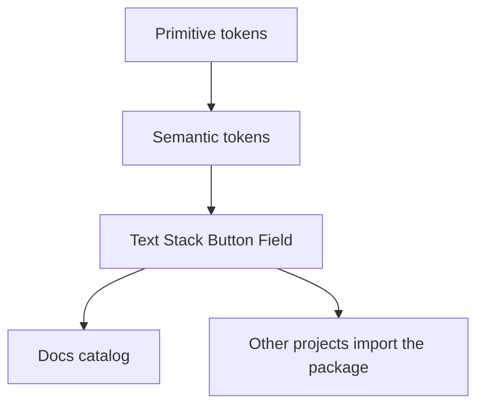

# Ray

Ray is a small React and TypeScript design system. This repo is both the component source and the catalog. Styling is CSS modules and CSS variables, so color, type, and spacing stay in one file.

## Run

```bash
npm install
npm run dev
```

- `npm run dev` starts the catalog
- `npm run build` typechecks and builds it
- `npm run preview` serves the production build

## How the layers connect



CSS custom properties in [`src/styles/tokens.css`](src/styles/tokens.css) are the source of truth. The browser applies them directly. There is no token compiler.

- **Primitive** tokens name the value: `--orange-500`, `--stone-50`, `--space-4`, `--font-display`.
- **Semantic** tokens name the role: `--color-bg`, `--color-text`, `--color-accent`, `--color-border`. Each one points at a primitive with `var()`.

Components read semantic tokens only. Dark mode is a `[data-theme="dark"]` block in the same file that points those names at different primitives. The palette stays put, so one toggle restyles every component.

[`src/styles/reset.css`](src/styles/reset.css) and [`src/styles/global.css`](src/styles/global.css) are the base element styles. Components live in `src/components`, one folder each for Text, Stack, Button, and Field. The catalog in `src/docs` has two views, Foundations and Components.

## Use ray-ui in another project

The package name is `ray-ui`. Public components are exported from [`src/index.ts`](src/index.ts). The token stylesheet is exported as `ray-ui/tokens.css`.

Depend on this folder:

```json
{
  "dependencies": {
    "ray-ui": "file:../ray-design-system"
  }
}
```

Load the tokens once, near the root of the app, and import the components you need:

```tsx
import "ray-ui/tokens.css";
import { Button, Field, Stack, Text } from "ray-ui";
```

React and React DOM are peer dependencies. The host app supplies them.

In Next.js, add `ray-ui` to `transpilePackages` so the TypeScript source is compiled with the app:

```ts
const nextConfig = {
  transpilePackages: ["ray-ui"],
};

export default nextConfig;
```
