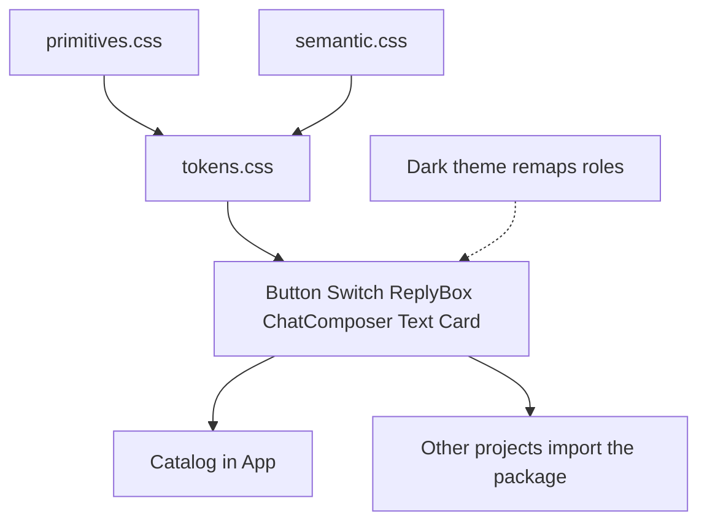

# Ray

Ray is a small React and TypeScript design system. This repo is both the component source and the catalog. Styling is CSS modules and CSS variables. Primitive values and semantic roles live in separate stylesheets, and [`src/styles/tokens.css`](src/styles/tokens.css) imports both.

## Run

```bash
npm install
npm run dev
```

- `npm run dev` starts the catalog
- `npm run build` typechecks and builds it
- `npm run lint` lints it
- `npm run preview` serves the production build

## How the layers connect



CSS custom properties are the source of truth. The browser applies them directly. There is no token compiler, so the same files load in the catalog, through the package exports, or in a host that assembles the layers itself.

[`src/styles/primitives.css`](src/styles/primitives.css) holds the raw values. That is the stone, gray, neutral, and black alpha ramps; the type ramp, leading, tracking, and weight; the space and radius scales; the `1px` border; and the motion durations and curves. Shadow ink (`--black-a0`, `--black-a12`, `--black-a16`, `--black-a24`) lives here too. Themes leave this file alone.

[`src/styles/semantic.css`](src/styles/semantic.css) holds the roles. Each role points at a primitive with `var()`. That includes surface, text, accent, border, and focus colors; text styles; semantic space, card padding, radius, and motion; and every shadow token from `--shadow-ring` through the card shadows. Those shadows are roles: `--shadow-ring` reads `--color-border`, and a theme reassigns the names. Light mode sets the roles on `:root`. `prefers-reduced-motion: reduce` is in this file and sets the semantic durations to `0ms`. The shadow-border rationale comment stays in this file with those roles.

[`src/styles/tokens.css`](src/styles/tokens.css) is the single entry point. It imports `primitives.css`, then `semantic.css`, so every role resolves. The catalog imports this file. The package exports `./tokens.css` and `./styles/tokens.css`, and both point at it.

Primitives name the value. Semantic tokens name the role. Components read semantic tokens only. A later dark theme is a third file that reassigns those same semantic names and leaves `primitives.css` alone. Load it after `tokens.css` (or after `semantic.css`, when the host imports the layers itself). Later declarations win, and Button, Switch, ReplyBox, ChatComposer, Text, and Card keep reading the same names.

The package exports the stylesheets, so another project can take the whole set or the layers:

- `ray-ui/tokens.css` and `ray-ui/styles/tokens.css` both load primitives, then semantic
- `ray-ui/primitives.css` is the raw values
- `ray-ui/semantic.css` is the light roles; import primitives first

The names below are unchanged. Raw values are defined in `primitives.css`. Roles are defined in `semantic.css`.

- **Color.** Stone is the warm neutral ramp and gray is the ink ramp. Both use the stops `0`, `50`, and `100` through `900`. Roles include `--color-bg`, `--color-bg-raised`, `--color-text`, `--color-accent`, `--color-border`, and `--color-control`. Quiet fills are `--color-quiet-hover` (`--stone-100`) and `--color-quiet-active` (`--stone-200`). Hairline borders use a shorter neutral scale, `--neutral-200` (`#D8D8D8`), `--neutral-300` (`#C4C4C4`), and `--neutral-400` (`#B0B0B0`), exposed as `--color-border-neutral`, `--color-border-neutral-hover`, and `--color-focus-neutral`. Shadow ink is `--black-a0` (`oklch(0 0 0 / 0)`), `--black-a12`, `--black-a16` (`oklch(0 0 0 / 0.16)`), and `--black-a24`.
- **Type.** Font sizes are a minor third. Each step is 1.2 times the step below, and `--text-sm` is the `1rem` base. Primitives are `--text-2xs` `0.6944rem`, `--text-xs` `0.8333rem`, `--text-sm` `1rem`, `--text-md` `1.2rem`, `--text-lg` `1.44rem`, `--text-xl` `1.728rem`, `--text-2xl` `2.0736rem`, `--text-3xl` `2.4883rem`, and `--text-4xl` `2.986rem`. Line-heights are `--leading-tight` `1.1`, `--leading-snug` `1.4`, `--leading-normal` `1.5`, and `--leading-relaxed` `1.75`. Letter-spacing is `--tracking-tighter` `-0.02em`, `--tracking-tight` `-0.01em`, `--tracking-normal` `0em`, and `--tracking-wide` `0.04em`. Weights are `--weight-regular` `400`, `--weight-medium` `500`, `--weight-semibold` `600`, and `--weight-bold` `700` (Geist static weights). Families are `--font-sans` (Geist) and `--font-mono` (Geist Mono).

  Semantic families are `--font-ui` and `--font-code`. Each text style is four semantic tokens, `--font-size-*`, `--font-leading-*`, `--font-tracking-*`, and `--font-weight-*`. Larger styles use tighter line-height and tracking.

  - `display` — `--text-4xl`, tight, tighter, semibold
  - `heading-lg` — `--text-2xl`, tight, tight, medium
  - `heading-md` — `--text-lg`, snug, tight, medium
  - `heading-sm` — `--text-sm`, snug, normal, medium
  - `body-lg` — `--text-md`, normal, normal, regular
  - `body` — `--text-xs`, normal, normal, regular
  - `body-sm` — `--text-2xs`, normal, normal, regular
  - `label` — `--text-xs`, snug, normal, medium
  - `caption` — `--text-2xs`, snug, normal, regular
  - `code` — `--text-2xs`, normal, normal, regular, `--font-code`

  Sizes already in the UI map onto that ramp: `0.75rem` is `--text-2xs` (caption and code), `0.875rem` is `--text-xs` (body and label), `1rem` stays `--text-sm` (heading-sm), and the `2rem` page title is `--text-2xl` (heading-lg). `--leading-relaxed`, `--tracking-wide`, and `--weight-bold` are primitives with no text style of their own. The catalog kicker uses `--tracking-wide`. Button and switch labels keep `line-height: 1` so the control box does not grow.

- **Space.** Primitive steps are `--space-0` through `--space-10`: `0`, `0.25rem`, `0.5rem`, `0.75rem`, `1rem`, `1.25rem`, `1.5rem`, `2rem`, `2.5rem`. Semantic names are one per step: `--space-none`, `--space-2xs`, `--space-xs`, `--space-sm`, `--space-md`, `--space-lg`, `--space-xl`, `--space-2xl`, `--space-3xl`. Card padding is another semantic layer on those primitives. With `1rem` at 16px, the default is `--space-card-block` → `--space-4` (16px) and `--space-card-inline` → `--space-3` (12px). `sm` is `--space-card-block-sm` → `--space-3` (12px) and `--space-card-inline-sm` → `--space-2` (8px). `lg` is `--space-card-block-lg` → `--space-6` (24px) and `--space-card-inline-lg` → `--space-4` (16px). `padding="none"` uses `--space-none`.
- **Radius.** Primitives are `--radius-none`, `--radius-sm`, `--radius-md`, `--radius-lg`, and `--radius-full`. Components use `--radius-control` for compact controls, `--radius-surface` for panels such as the reply box and the card, and `--radius-pill` for buttons and switches.
- **Motion.** Primitive durations are `--time-150`, `--time-280`, `--time-360`, `--time-500`, and `--time-700`. Primitive curves are `--curve-linear`, `--curve-standard` (the CSS `ease` keyword), `--curve-out`, `--curve-in-out`, `--curve-decelerate`, and `--curve-spring` (a `linear()` spring). Semantic durations are `--duration-fast`, `--duration-base`, `--duration-slow`, `--duration-slower`, and `--duration-loop`. Semantic curves are `--ease-linear`, `--ease-standard`, `--ease-out`, `--ease-in-out`, `--ease-decelerate`, and `--ease-spring`. `prefers-reduced-motion: reduce` sets the semantic durations to `0ms`.
- **Shadow.** A surface edge is a box-shadow ring, not a CSS border. `--shadow-ring` is `0 0 0 0.5px var(--color-border)`. `--shadow-ring-strong` uses `--color-border-strong`. `--shadow-flat` is a zero layer on `--black-a0`, so a shadow list can keep a fixed length and transition. `--shadow-contact` and `--shadow-contact-soft` are the two tight layers. `--shadow-border` composes the ring plus those two contact layers, and Button primary uses it. The painted result of `--shadow-border` is the same as before. Lifts are `--shadow-lift-soft`, `--shadow-lift`, and `--shadow-lift-strong`. Card roles are `--shadow-card`, `--shadow-card-hover`, `--shadow-card-active`, and the same trio with `-outline` and `-elevated`. Why the ring is a shadow is in [Card](#card).

[`src/styles/reset.css`](src/styles/reset.css) and [`src/styles/global.css`](src/styles/global.css) are the base element styles. Components live in `src/components`, one folder each for Button, Switch, ReplyBox, ChatComposer, Text, and Card. The catalog is [`src/App.tsx`](src/App.tsx).

`Text` renders one text style. `variant` is `display`, `heading-lg`, `heading-md`, `heading-sm`, `body-lg`, `body`, `body-sm`, `label`, `caption`, or `code`. The default variant is `body`. `as` sets the element. When `as` is omitted, the element is `h1` for display, `h2` for heading-lg, `h3` for heading-md, `h4` for heading-sm, `p` for the body styles, `span` for label and caption, and `code` for code. `tone` is `default` (`--color-text`) or `muted` (`--color-text-muted`). Any other attribute, including `className`, is passed through.

## Card

`Card` is a surface for a note, a study, or a link. The default variant is `surface`: `--color-bg-raised`, `--shadow-card`, `--radius-surface`, and padding `--space-card-block` (16px) by `--space-card-inline` (12px). `variant` is `surface`, `outline`, `elevated`, or `ghost`. `ghost` has no fill and no shadow. `padding` is `none`, `sm`, `md`, or `lg`. The default padding is `md`.

`as` sets the element, as it does on `Text`. The default element is `div`. If `href` is set and `as` is omitted, the element is `a`. `as="a"` and `as="button"` are interactive: pointer, hover and active shadows, and the same focus-visible outline as Button and Switch (`2px solid var(--color-focus)`, offset 2px). The outline sits outside the shadow border, so the hairline stays. A button card defaults `type` to `button`. Do not put a link, button, or input inside an interactive card. A static card can. `CardFooter` holding a `Button` is the static pattern.

`CardHeader`, `CardBody`, `CardFooter`, and `CardMedia` are optional regions. Media bleeds to the card edges and clips to `--radius-surface`. Padding still applies to the other regions. Any other attribute, including `className`, is passed through.

The edge is a `box-shadow`, not a CSS `border`. A border is part of the box, so turning it on would grow the card and shift the content off the padding. The default padding stays exactly 12px inline and 16px block on every variant and state, including `ghost`, which draws no edge. The hairline and the elevation are layers of one `box-shadow`. Hover and active use lists of the same length (`--shadow-flat` stands in when a state has no lift), and that property transitions with `--duration-fast` and `--ease-standard`. The ring is `0.5px`, follows `--radius-surface`, and uses `--color-border`, a translucent `oklch` color, so it sits on the rounded corner and blends with the stone instead of painting a solid stroke. A later dark theme reassigns these semantic tokens and leaves the component alone.

`prefers-reduced-motion: reduce` sets `--duration-fast` to `0ms`. Hover and active still change the shadow and the fill. They do not tween. Nothing in the press moves the content. The box size stays the same.

Shadow roles:

- `--shadow-card` is `--shadow-border` plus `--shadow-flat`. `--shadow-card-hover` swaps the flat layer for `--shadow-lift-soft`. `--shadow-card-active` is `--shadow-card` again, with `--color-quiet-hover` as the pressed fill.
- `--shadow-card-outline` is `--shadow-ring` plus three flat layers. Hover uses `--shadow-ring-strong` and `--shadow-contact`, on `--color-quiet-hover`. Active keeps the strong ring, drops the contact layer, and fills with `--color-quiet-active`.
- `--shadow-card-elevated` is `--shadow-border` plus `--shadow-lift`. Hover uses `--shadow-lift-strong`. Active settles to `--shadow-card` and fills with `--color-quiet-hover`.
- `ghost` sets `box-shadow: none`. Interactive hover fills with `--color-quiet-hover`. Interactive active fills with `--color-quiet-active`.

## Use ray-ui in another project

The package name is `ray-ui`. Public components are exported from [`src/index.ts`](src/index.ts). The token entry is exported as `ray-ui/tokens.css` and `ray-ui/styles/tokens.css`. The layers are also exported as `ray-ui/primitives.css` and `ray-ui/semantic.css`.

Depend on this folder:

```json
{
  "dependencies": {
    "ray-ui": "file:../ray-design-system"
  }
}
```

Load the tokens once, near the root of the app, and import the components you need:

```tsx
import "ray-ui/tokens.css";
import { Button, Card, ChatComposer, ReplyBox, Switch, Text } from "ray-ui";
```

`ray-ui/tokens.css` imports primitives, then semantic roles. `ray-ui/styles/tokens.css` is the same file. To assemble the layers yourself, import them in that order:

```tsx
import "ray-ui/primitives.css";
import "ray-ui/semantic.css";
```

A dark theme, once it exists, is a third import after those. It remaps the semantic roles and leaves the primitives in place.

React and React DOM are peer dependencies. The host app supplies them.

In Next.js, add `ray-ui` to `transpilePackages` so the TypeScript source is compiled with the app:

```ts
const nextConfig = {
  transpilePackages: ["ray-ui"],
};

export default nextConfig;
```
