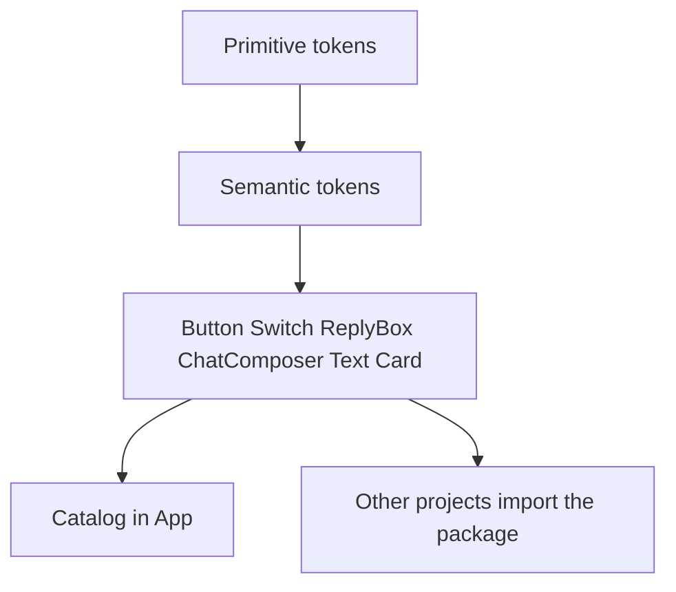

# Ray

Ray is a small React and TypeScript design system. This repo is both the component source and the catalog. Styling is CSS modules and CSS variables, so color, type, spacing, radius, and motion stay in one file.

## Run

```bash
npm install
npm run dev
```

- `npm run dev` starts the catalog
- `npm run build` typechecks and builds it
- `npm run lint` lints it
- `npm run preview` serves the production build

## How the layers connect



CSS custom properties in [`src/styles/tokens.css`](src/styles/tokens.css) are the source of truth. The browser applies them directly. There is no token compiler.

Primitives name the value. Semantic tokens name the role and point at a primitive with `var()`. Components read semantic tokens only. Light mode sets those roles on `:root`. Dark mode is not wired up yet. When it is, it reassigns the same semantic names and leaves the primitives alone.

- **Color.** Stone is the warm neutral ramp and gray is the ink ramp. Both use the stops `0`, `50`, and `100` through `900`. Roles include `--color-bg`, `--color-text`, `--color-accent`, `--color-border`, and `--color-control`. Hairline borders use a shorter neutral scale, `--neutral-200` (`#D8D8D8`), `--neutral-300` (`#C4C4C4`), and `--neutral-400` (`#B0B0B0`), exposed as `--color-border-neutral`, `--color-border-neutral-hover`, and `--color-focus-neutral`. Surface roles are `--color-surface` (`--color-bg-raised`), `--color-surface-hover` (`--color-quiet-hover`), and `--color-surface-active` (`--stone-200`).
- **Elevation.** `--shadow-surface` is a short resting shadow (`0 1px 2px` over `--black-a12`). `--shadow-raised` adds `0 8px 16px -2px` over `--black-a24`. `--shadow-overlay` is the lifted hover, `0 2px 6px` over `--black-a12` and `0 16px 28px -4px` over `--black-a24`.
- **Type.** Font sizes are a minor third. Each step is 1.2 times the step below, and `--text-sm` is the `1rem` base. Primitives are `--text-2xs` `0.6944rem`, `--text-xs` `0.8333rem`, `--text-sm` `1rem`, `--text-md` `1.2rem`, `--text-lg` `1.44rem`, `--text-xl` `1.728rem`, `--text-2xl` `2.0736rem`, `--text-3xl` `2.4883rem`, and `--text-4xl` `2.986rem`. Line-heights are `--leading-tight` `1.1`, `--leading-snug` `1.4`, `--leading-normal` `1.5`, and `--leading-relaxed` `1.75`. Letter-spacing is `--tracking-tighter` `-0.02em`, `--tracking-tight` `-0.01em`, `--tracking-normal` `0em`, and `--tracking-wide` `0.04em`. Weights are `--weight-regular` `400`, `--weight-medium` `500`, `--weight-semibold` `600`, and `--weight-bold` `700` (Geist static weights). Families are `--font-sans` (Geist) and `--font-mono` (Geist Mono).

  Semantic families are `--font-ui` and `--font-code`. Each text style is four semantic tokens, `--font-size-*`, `--font-leading-*`, `--font-tracking-*`, and `--font-weight-*`. Larger styles use tighter line-height and tracking.

  - `display` — `--text-4xl`, tight, tighter, semibold
  - `heading-lg` — `--text-2xl`, tight, tight, medium
  - `heading-md` — `--text-lg`, snug, tight, medium
  - `heading-sm` — `--text-sm`, snug, normal, medium
  - `body-lg` — `--text-md`, normal, normal, regular
  - `body` — `--text-xs`, normal, normal, regular
  - `body-sm` — `--text-2xs`, normal, normal, regular
  - `label` — `--text-xs`, snug, normal, medium
  - `caption` — `--text-2xs`, snug, normal, regular
  - `code` — `--text-2xs`, normal, normal, regular, `--font-code`

  Sizes already in the UI map onto that ramp: `0.75rem` is `--text-2xs` (caption and code), `0.875rem` is `--text-xs` (body and label), `1rem` stays `--text-sm` (heading-sm), and the `2rem` page title is `--text-2xl` (heading-lg). `--leading-relaxed`, `--tracking-wide`, and `--weight-bold` are primitives with no text style of their own. The catalog kicker uses `--tracking-wide`. Button and switch labels keep `line-height: 1` so the control box does not grow.
- **Space.** Primitive steps are `--space-0` through `--space-10`: `0`, `0.25rem`, `0.5rem`, `0.75rem`, `1rem`, `1.25rem`, `1.5rem`, `2rem`, `2.5rem`. Semantic names are one per step: `--space-none`, `--space-2xs`, `--space-xs`, `--space-sm`, `--space-md`, `--space-lg`, `--space-xl`, `--space-2xl`, `--space-3xl`.
- **Radius.** Primitives are `--radius-none`, `--radius-sm`, `--radius-md`, `--radius-lg`, and `--radius-full`. Components use `--radius-control` for compact controls, `--radius-surface` for panels such as the reply box and cards, and `--radius-pill` for buttons and switches.
- **Motion.** Primitive durations are `--time-150`, `--time-280`, `--time-360`, `--time-500`, and `--time-700`. Primitive curves are `--curve-linear`, `--curve-standard` (the CSS `ease` keyword), `--curve-out`, `--curve-in-out`, `--curve-decelerate`, and `--curve-spring` (a `linear()` spring). Semantic durations are `--duration-fast`, `--duration-base`, `--duration-slow`, `--duration-slower`, and `--duration-loop`. Semantic curves are `--ease-linear`, `--ease-standard`, `--ease-out`, `--ease-in-out`, `--ease-decelerate`, and `--ease-spring`. `prefers-reduced-motion: reduce` sets the semantic durations to `0ms`.

[`src/styles/reset.css`](src/styles/reset.css) and [`src/styles/global.css`](src/styles/global.css) are the base element styles. Components live in `src/components`, one folder each for Button, Switch, ReplyBox, ChatComposer, Text, and Card. The catalog is [`src/App.tsx`](src/App.tsx).

`Text` renders one text style. `variant` is `display`, `heading-lg`, `heading-md`, `heading-sm`, `body-lg`, `body`, `body-sm`, `label`, `caption`, or `code`. The default variant is `body`. `as` sets the element. When `as` is omitted, the element is `h1` for display, `h2` for heading-lg, `h3` for heading-md, `h4` for heading-sm, `p` for the body styles, `span` for label and caption, and `code` for code. `tone` is `default` (`--color-text`) or `muted` (`--color-text-muted`). Any other attribute, including `className`, is passed through.

`Card` is a surface for a note, a link, or a small study. `variant` is `outlined` (the default), `elevated`, or `ghost`. Outlined paints `--color-surface`, a `--color-border` hairline, `--radius-surface`, and `--shadow-surface`. Elevated keeps that fill and hairline and lifts with `--shadow-raised`; an interactive elevated card uses `--shadow-overlay` while hovered. Ghost has no fill, border, or shadow until interaction. `padding` is `none`, `sm` (`--space-sm`), `md` (`--space-md`, the default), or `lg` (`--space-xl`). `as` sets the element and defaults to `div`. Passing `href` without `as` renders an anchor. When the element is `a` or `button`, the card is interactive: pointer cursor, `--color-surface-hover` on hover, `--color-surface-active` while pressed, and the same focus-visible ring as Button. A button card sets `type` to `button` unless one is provided. `aria-pressed="true"` draws an accent border. An interactive card stays free of nested links and buttons. `Card.Header`, `Card.Body`, `Card.Footer`, and `Card.Media` are optional regions, also exported as `CardHeader`, `CardBody`, `CardFooter`, and `CardMedia`. Media cancels the card padding so a picture sits flush with the rounded edge. Any other attribute, including `className`, is passed through. Hover, border, and shadow transitions use `--duration-fast` and `--ease-standard`, which are `0ms` under `prefers-reduced-motion`.

## Use ray-ui in another project

The package name is `ray-ui`. Public components are exported from [`src/index.ts`](src/index.ts). The token stylesheet is exported as `ray-ui/tokens.css`.

Depend on this folder:

```json
{
  "dependencies": {
    "ray-ui": "file:../ray-design-system"
  }
}
```

Load the tokens once, near the root of the app, and import the components you need:

```tsx
import "ray-ui/tokens.css";
import { Button, Card, ChatComposer, ReplyBox, Switch, Text } from "ray-ui";
```

React and React DOM are peer dependencies. The host app supplies them.

In Next.js, add `ray-ui` to `transpilePackages` so the TypeScript source is compiled with the app:

```ts
const nextConfig = {
  transpilePackages: ["ray-ui"],
};

export default nextConfig;
```
