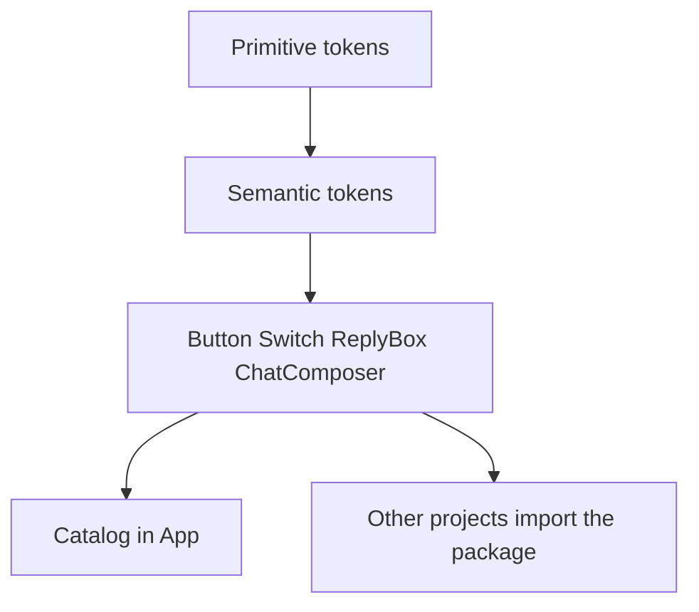

# Ray

Ray is a small React and TypeScript design system. This repo is both the component source and the catalog. Styling is CSS modules and CSS variables, so color, type, spacing, radius, and motion stay in one file.

## Run

```bash
npm install
npm run dev
```

- `npm run dev` starts the catalog
- `npm run build` typechecks and builds it
- `npm run lint` lints it
- `npm run preview` serves the production build

## How the layers connect



CSS custom properties in [`src/styles/tokens.css`](src/styles/tokens.css) are the source of truth. The browser applies them directly. There is no token compiler.

Primitives name the value. Semantic tokens name the role and point at a primitive with `var()`. Components read semantic tokens only. Light mode sets those roles on `:root`. Dark mode is not wired up yet. When it is, it reassigns the same semantic names and leaves the primitives alone.

- **Color.** Stone is the warm neutral ramp and gray is the ink ramp. Both use the stops `0`, `50`, and `100` through `900`. Roles include `--color-bg`, `--color-text`, `--color-accent`, `--color-border`, and `--color-control`. Hairline borders use a shorter neutral scale, `--neutral-200` (`#D8D8D8`), `--neutral-300` (`#C4C4C4`), and `--neutral-400` (`#B0B0B0`), exposed as `--color-border-neutral`, `--color-border-neutral-hover`, and `--color-focus-neutral`.
- **Type.** `--font-sans`, the text sizes, and `--weight-medium` are primitives. Components use `--font-ui`, `--font-size-sm`, `--font-size-md`, `--font-size-lg`, and `--font-weight-label`.
- **Space.** Primitive steps are `--space-0` through `--space-10`: `0`, `0.25rem`, `0.5rem`, `0.75rem`, `1rem`, `1.25rem`, `1.5rem`, `2rem`, `2.5rem`. Semantic names are one per step: `--space-none`, `--space-2xs`, `--space-xs`, `--space-sm`, `--space-md`, `--space-lg`, `--space-xl`, `--space-2xl`, `--space-3xl`.
- **Radius.** Primitives are `--radius-none`, `--radius-sm`, `--radius-md`, `--radius-lg`, and `--radius-full`. Components use `--radius-control` for compact controls, `--radius-surface` for panels such as the reply box, and `--radius-pill` for buttons and switches.
- **Motion.** Primitive durations are `--time-150`, `--time-280`, `--time-360`, `--time-500`, and `--time-700`. Primitive curves are `--curve-linear`, `--curve-standard` (the CSS `ease` keyword), `--curve-out`, `--curve-in-out`, `--curve-decelerate`, and `--curve-spring` (a `linear()` spring). Semantic durations are `--duration-fast`, `--duration-base`, `--duration-slow`, `--duration-slower`, and `--duration-loop`. Semantic curves are `--ease-linear`, `--ease-standard`, `--ease-out`, `--ease-in-out`, `--ease-decelerate`, and `--ease-spring`. `prefers-reduced-motion: reduce` sets the semantic durations to `0ms`.

[`src/styles/reset.css`](src/styles/reset.css) and [`src/styles/global.css`](src/styles/global.css) are the base element styles. Components live in `src/components`, one folder each for Button, Switch, ReplyBox, and ChatComposer. The catalog is [`src/App.tsx`](src/App.tsx).

## Use ray-ui in another project

The package name is `ray-ui`. Public components are exported from [`src/index.ts`](src/index.ts). The token stylesheet is exported as `ray-ui/tokens.css`.

Depend on this folder:

```json
{
  "dependencies": {
    "ray-ui": "file:../ray-design-system"
  }
}
```

Load the tokens once, near the root of the app, and import the components you need:

```tsx
import "ray-ui/tokens.css";
import { Button, ChatComposer, ReplyBox, Switch } from "ray-ui";
```

React and React DOM are peer dependencies. The host app supplies them.

In Next.js, add `ray-ui` to `transpilePackages` so the TypeScript source is compiled with the app:

```ts
const nextConfig = {
  transpilePackages: ["ray-ui"],
};

export default nextConfig;
```
